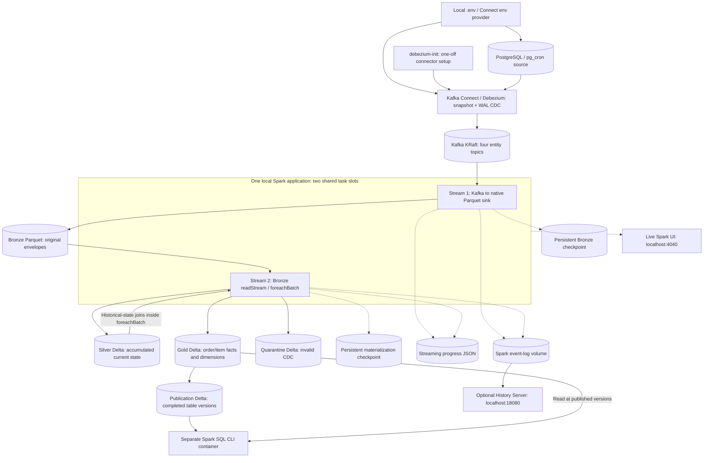
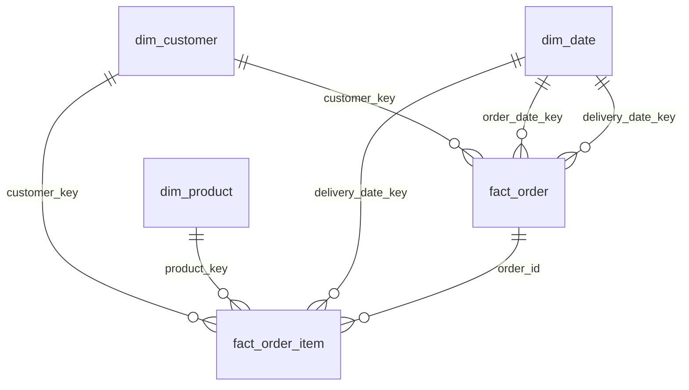

# Architecture and data contracts

There are two independent streaming checkpoints. Kafka ingestion can continue while materialization catches up. In the small local deployment both queries share one Spark application; an unrecoverable query failure stops that application and Compose restarts it. Kafka and Bronze absorb the backlog. One materializer owns Silver/Gold/publication; multiple concurrent writers are not supported by this application.

## Storage choices

Bronze is append-only Snappy Parquet, with no interpretation of the business payload. Its fixed schema holds key/value as bytes and Kafka coordinates. This avoids schema coupling to the source and does not require table-level update semantics at ingestion. Native streaming sink metadata and checkpoints must be preserved along with its files. Reading arbitrary file globs or moving files outside that protocol weakens the commit guarantees.

Silver and Gold require mutations, so they use Delta rather than raw Parquet. Decimal values are decoded as strings at Debezium and cast explicitly downstream; date values use Debezium's epoch-day representation. All Spark sessions use UTC. Schema additions remain in Bronze; changes that break the selected fields/contract block publication and require a deliberate parser update.

The demo does not partition small tables. Partitioning by order/customer IDs would create excessive directories; partitioning mutable orders by delivery date can force expensive moves. Large deployments need measured file layout/compaction, not blanket high-cardinality partitioning. See the performance strategy.

## Dimensional grains

The fact-to-fact relationship documents lineage; the order-count queries intentionally query only the order fact. Order items carry the current parent's status/date/customer for direct operational filtering. An order change recomputes its affected items from Silver. An item change recomputes that item; unrelated facts are not rewritten. Dimensions use SCD1 and stable source IDs rather than an additional surrogate-key allocation service.

## Joining CDC with historical data

Here, historical data means the rows present in the initial Debezium snapshot plus the current state accumulated from earlier microbatches. Those rows are persisted in Silver Delta and remain available even when their keys have no event in the current batch. It does not mean a point-in-time lookup of every past status or attribute version.

`materialize_batch()` first applies CDC to Silver. Then `refresh_gold()` opens the accumulated Silver `orders` and `order_items` tables for the current batch and performs these joins:

| Trigger | Historical lookup | Result |
|---|---|---|
| A new or changed item | Join the affected Silver item to the stored order on `order_id` in `item_fact()` | The item inherits the order's current status, customer and delivery date, even if the order has no event in this batch |
| A changed order | Semi-join stored Silver items to changed order IDs, then join those items to stored orders | Previously ingested items reflect the parent's new state without requiring another item event |
| A current order-count query | Query the accumulated order fact, with date/customer dimension joins where needed | Counts include both preexisting and newly created orders |

These are batch DataFrame joins inside Structured Streaming's `foreachBatch`, with the persisted state refreshed each batch. A stream-stream window join is not required for this enrichment and could evict old orders that must remain queryable.

The integration test explicitly loads an order through a snapshot event, processes several later batches, and then sends a new item for that unchanged order alongside a newly created order. It verifies the new item's inherited attributes and metrics combining old and new records. The existing parent-status-change scenario also verifies that historical item rows are refreshed without new events for each child.

## Consistency boundary

Each Silver key retains `_lsn`, `_offset`, `_partition` and `_deleted`. Within a batch, window ordering selects the latest version; across batches, MERGE updates only on a greater LSN, or a greater offset at equal LSN. This relies on the same Kafka key retaining its partition ordering; topic repartitioning/identity changes need a controlled migration. Deletion guards are not automatically purged.

After all fact/dimension writes succeed, a single-row `gold/publication` transaction records their Delta versions, source batch ID, input count, timestamp and materialization duration. A reader captures this row once and uses `versionAsOf` for every table. A crash before publication exposes none of the incomplete table changes through the supported CLI. A retry rereads authoritative Silver state and regenerates affected Gold rows before publishing. Source CDC transactions split across topics/batches are eventually reconciled; no globally atomic source-transaction view is claimed.

The source's initial snapshot supplies preexisting records; Bronze preserves later events. Delta time travel and Bronze retention support debugging/replay, but the dimensional contract remains current state. A long-lived historical state reporting requirement would need an additional versioned fact/SCD2 design.

## Production boundary

Named local volumes deliberately make the demo reproducible without adding an object-store emulator or a query server. A distributed Spark deployment must replace these with durable storage accessible at the same URI from every executor, using Delta's supported storage/log-store configuration. Merely changing `--master` does not turn local disk into distributed storage.

Production adds replicated Kafka, checkpoint/storage durability, authenticated/TLS connections, secrets management, source WAL/slot monitoring, data retention, a single-writer deployment policy and alerts. An API or always-on SQL engine can replace the CLI when query concurrency or interactive response time justifies another service; it must honor the publication version contract.
